# Bhumi Enterprise

A production-ready full-stack business website for Bhumi Enterprise, Bahadurgarh.

The website presents battery products and WiFi services, accepts customer enquiries and reviews, and includes a secure administration system for managing website content.

## Live Website

[https://bhumi-enterprise.vercel.app](https://bhumi-enterprise.vercel.app)

A custom business domain can be connected after approval from the business owner.

## Project Overview

Bhumi Enterprise is an authorised Tata Green Batteries distributor in Bahadurgarh. The business also supplies Geon and Amaron batteries and provides WiFi-related assistance.

The website enables customers to:

- browse battery categories;
- search and filter battery products;
- find compatible batteries using vehicle manufacturer and model;
- view battery prices, capacities and warranty information;
- receive free battery installation;
- receive free battery checkup;
- request WiFi assistance;
- contact the business using Gmail, phone or WhatsApp;
- open the business location in Google Maps;
- submit customer enquiries;
- submit customer reviews;
- view approved customer feedback.

The administration system enables authorised administrators to:

- create, edit and delete battery products;
- upload battery images;
- publish, hide or discontinue products;
- manage battery categories;
- manage exact vehicle compatibility;
- create and edit WiFi services;
- configure service-specific WiFi questions;
- review customer enquiries;
- approve, reject or hide customer reviews;
- update business and contact information;
- update Google Maps information;
- recover an administrator password securely.

## Technology Stack

### Frontend

- Next.js 16
- React 19
- TypeScript
- Tailwind CSS 4
- Lucide React icons
- Next.js Image optimisation

### Backend

- Next.js App Router
- Server Components
- Server Actions
- Route Handlers
- Secure HTTP-only administrator sessions
- Form validation
- Database-backed content management

### Database and Services

- Neon PostgreSQL
- Vercel deployment
- Vercel Blob public image storage
- Vercel OIDC authentication
- Resend transactional email
- Google Maps directions
- WhatsApp customer assistance

## Major Features

### Responsive Business Website

The website is designed for desktop, tablet and mobile displays.

It includes:

- responsive navigation;
- mobile navigation menu;
- illustrative homepage hero background;
- smooth section navigation;
- responsive service cards;
- fixed background watermark outside the hero and footer;
- mobile footer accordions;
- accessible keyboard focus states;
- loading, error and custom 404 pages.

### Battery Catalogue

The battery catalogue includes:

- Two-Wheeler Batteries
- Car / MUV / SUV Batteries
- Tractor Batteries
- Commercial Vehicle Batteries
- E-Rickshaw Batteries
- Inverter Batteries
- Genset Batteries
- Industrial Batteries
- Inverter / UPS Systems

Customers can filter products using:

- battery name or model search;
- capacity;
- warranty;
- availability status;
- confirmed vehicle manufacturer;
- confirmed vehicle model.

Only nine battery cards are initially displayed. The **More Batteries** button displays the next group of products.

Products without an available image intentionally display a clean blank image area without an “image unavailable” message.

### Vehicle Compatibility

Administrators can:

- add vehicle manufacturers;
- add vehicle models and variants;
- add fuel types and year ranges;
- connect a vehicle model to one or more batteries;
- mark the best matching battery as recommended;
- remove incorrect compatibility records.

Public battery recommendations are displayed only after compatibility has been confirmed by the business.

### WiFi Services

WiFi functionality includes:

- installation enquiries;
- router configuration;
- WiFi repair;
- coverage assistance;
- maintenance support;
- Airtel ISP information;
- service-specific questions;
- optional internet-speed requirements where relevant;
- address and preferred-time collection;
- direct WhatsApp assistance.

Additional WiFi services and questions can be configured through the administration panel.

### Contact and Location

Customers can:

- open Gmail Compose;
- copy the business phone number;
- open the mobile phone dialler;
- contact the owner on WhatsApp;
- open the business location in Google Maps;
- submit a structured contact enquiry.

### Customer Reviews

Reviews use an approval workflow:

1. A customer submits a review.
2. The review is stored with pending status.
3. An administrator reviews the submission.
4. Approved reviews become publicly visible.
5. Rejected or hidden reviews remain private.

### Secure Administration

The administration system includes:

- support for multiple administrator accounts;
- password hashing using bcrypt;
- signed HTTP-only session cookies;
- protected administration routes;
- administrator login and logout;
- rate-limited password recovery;
- expiring password recovery codes;
- administrator account status checks;
- a non-prominent public administration entry point.

Security does not depend on the administration URL remaining secret. Access requires valid credentials and a signed administrator session.

### Central Website Settings

Business information is managed from one administration page.

Administrators can update:

- business name;
- business tagline;
- public email;
- phone number;
- WhatsApp number;
- address;
- Google Maps search query;
- business hours;
- supported ISP;
- established year.

Saving these settings updates the public website without requiring source-code changes.

### Cloud Image Uploads

Battery images uploaded through the administration system are stored in a public Vercel Blob store.

The upload system:

- requires administrator authentication;
- accepts JPG, JPEG, PNG and WebP;
- limits uploads to 4 MB;
- creates unique Blob paths;
- stores the uploaded image URL in PostgreSQL;
- uses Vercel OIDC instead of exposing a permanent Blob token.

## Application Routes

### Public Routes

- `/` — Homepage
- `/batteries` — Battery categories
- `/batteries/[category]` — Dynamic battery catalogue
- `/wifi-services` — WiFi service categories
- `/wifi-services/[service]` — Dynamic WiFi enquiry form
- `/contact` — Contact page and Google Maps
- `/reviews` — Customer reviews and feedback form

### Administration Routes

- `/admin/login` — Administrator login
- `/admin/forgot-password` — Password recovery
- `/admin` — Administration dashboard
- `/admin/batteries` — Battery management
- `/admin/batteries/compatibility` — Vehicle compatibility
- `/admin/wifi` — WiFi service management
- `/admin/reviews` — Review approval
- `/admin/enquiries` — Customer enquiries
- `/admin/settings` — Central website settings

Administration routes require valid administrator authentication.

## Screenshots

### Live Production Homepage

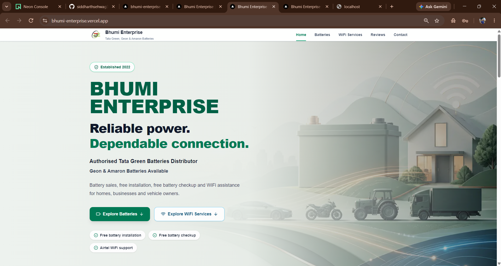

### Hero Design

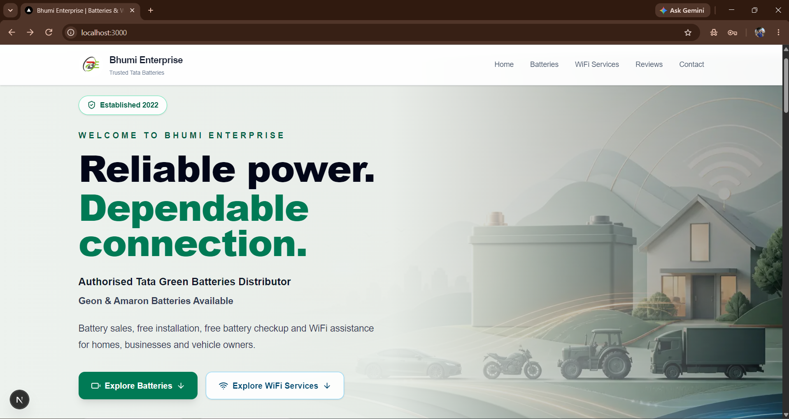

### Battery Catalogue

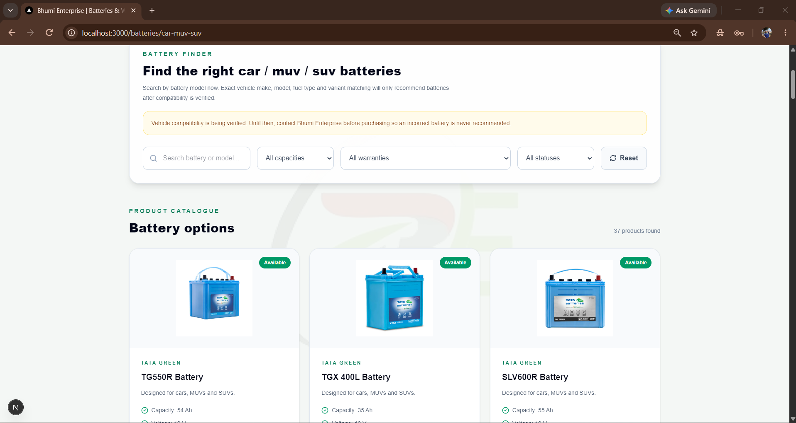

### WiFi Services

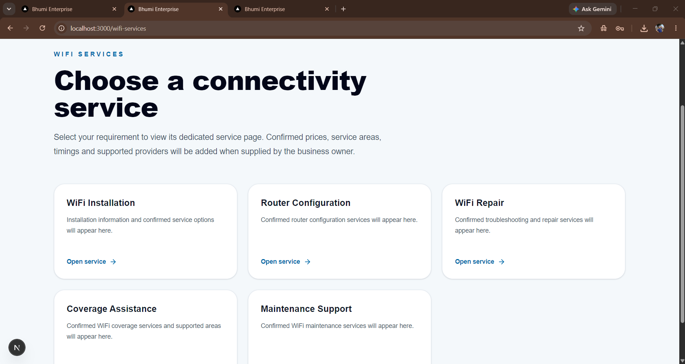

### Contact and Google Maps

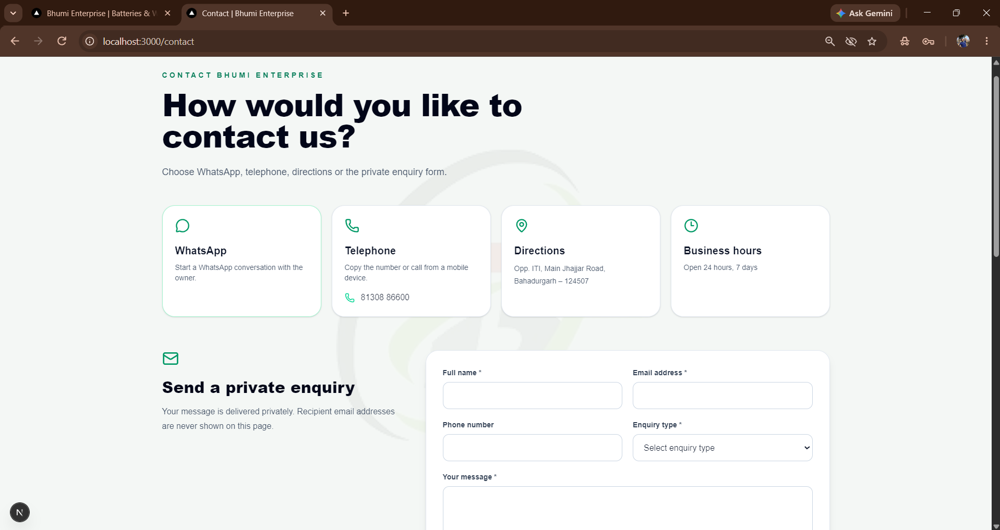

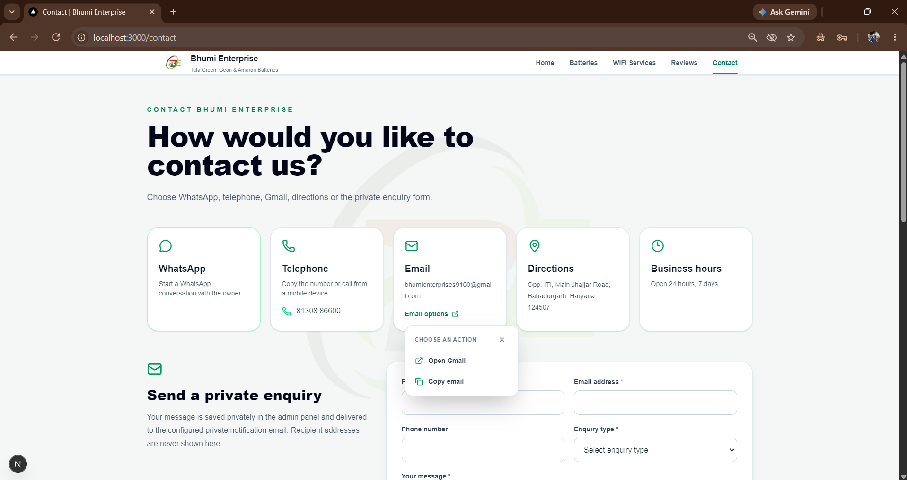

### Customer Reviews

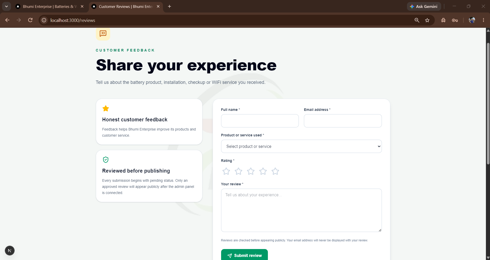

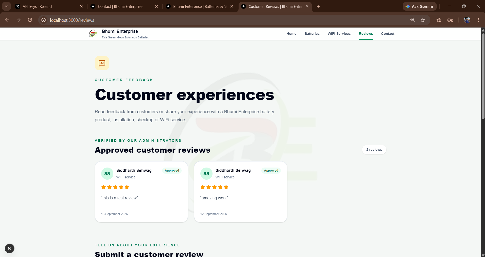

### Mobile Layout

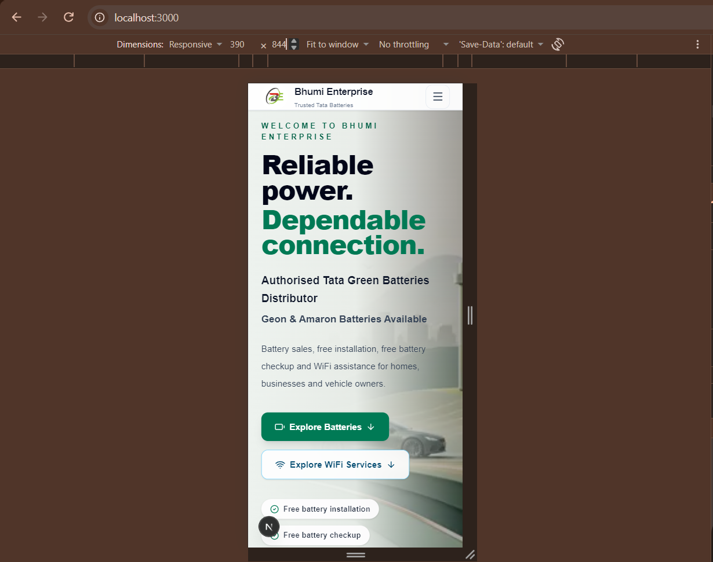

### Administration

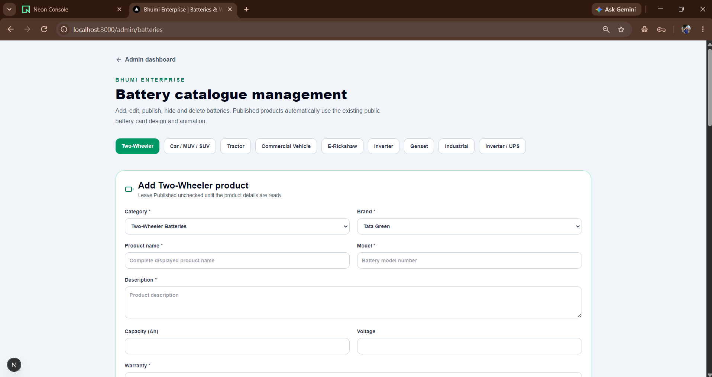

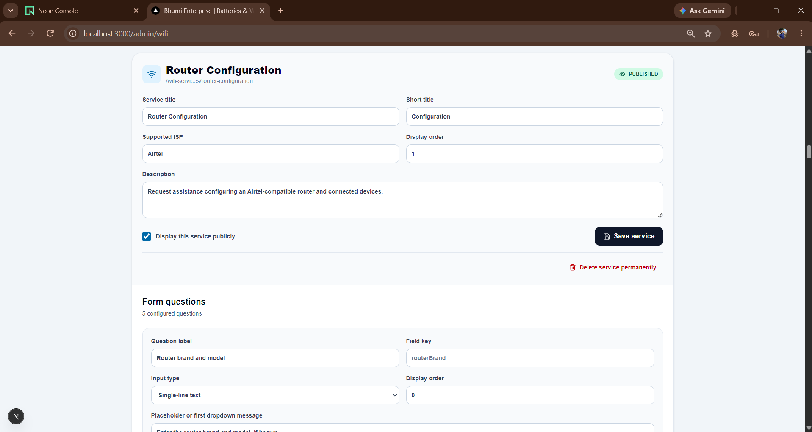

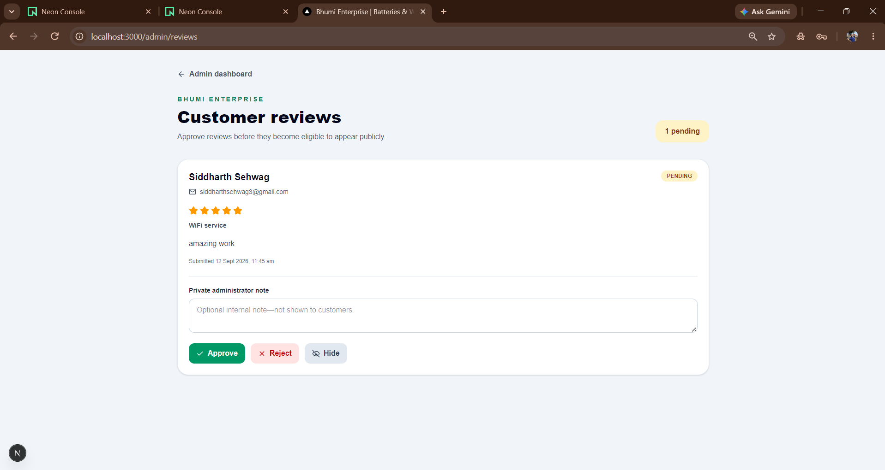

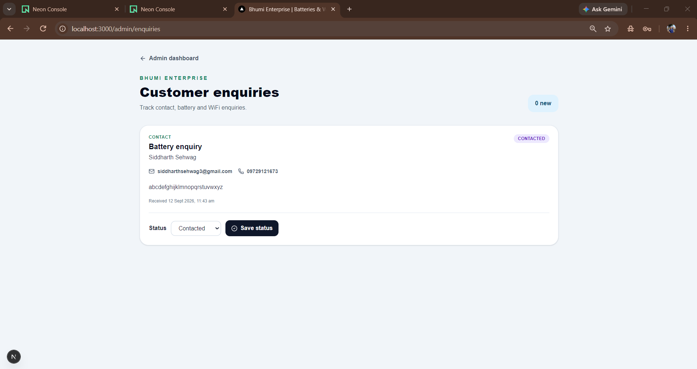

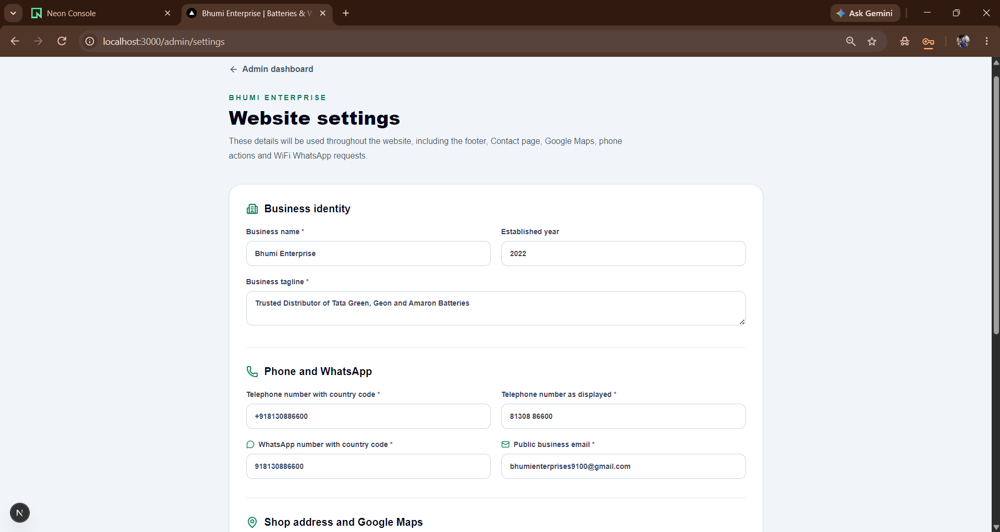

## Local Development

### Requirements

Install or create access to:

- Node.js
- npm
- Neon PostgreSQL
- Resend
- Vercel
- Vercel Blob

### Installation

Clone the repository:

```bash
git clone https://github.com/siddharthsehwag3-ai/bhumi-enterprise.git
```

Enter the project:

```bash
cd bhumi-enterprise
```

Install dependencies:

```bash
npm install
```

Create a file named `.env.local` in the project root.

Do not commit `.env.local` to GitHub.

Add the required variables:

```env
DATABASE_URL="your-neon-postgresql-connection-string"
SESSION_SECRET="your-long-random-session-secret"

RESEND_API_KEY="your-resend-api-key"
EMAIL_FROM="Bhumi Enterprise <your-verified-sender-address>"
SUBMISSION_RECIPIENT_EMAILS="your-private-recipient-email"
ADMIN_RECOVERY_EMAIL="your-private-recovery-email"

NEXT_PUBLIC_SITE_URL="http://localhost:3000"
```

Do not place real passwords, API keys, database credentials or private email configuration in the README.

### Start the Development Server

```bash
npm run dev
```

Open:

```text
http://localhost:3000
```

### Stop the Development Server

In the terminal running Next.js, press:

```text
Ctrl + C
```

## Database Setup

The SQL files are stored in the `database` directory.

Run them in this order:

1. `database/schema.sql`
2. `database/002-admin-users.sql`
3. `database/004-admin-password-resets.sql`

These scripts create the tables and indexes required for:

- battery categories;
- battery products;
- vehicle manufacturers;
- vehicle models;
- battery compatibility;
- WiFi services;
- WiFi questions;
- reviews;
- enquiries;
- website settings;
- administrator accounts;
- administrator password recovery.

Administrator passwords must be stored as secure bcrypt hashes. Plain-text administrator passwords must never be committed to GitHub.

## Environment Variables

The application uses the following environment variables:

| Variable | Purpose | Secret |
| --- | --- | --- |
| `DATABASE_URL` | Neon PostgreSQL connection | Yes |
| `SESSION_SECRET` | Signs administrator sessions | Yes |
| `RESEND_API_KEY` | Sends transactional emails | Yes |
| `EMAIL_FROM` | Verified sender identity | Configuration |
| `SUBMISSION_RECIPIENT_EMAILS` | Receives enquiries and reviews | Private configuration |
| `ADMIN_RECOVERY_EMAIL` | Receives password recovery codes | Private configuration |
| `NEXT_PUBLIC_SITE_URL` | Public website address | No |

Vercel may also provide these variables automatically:

- `VERCEL_URL`
- `VERCEL_PROJECT_PRODUCTION_URL`
- Vercel Blob OIDC configuration variables

Do not expose secret variables by using a `NEXT_PUBLIC_` prefix.

## Email Behaviour

Customer enquiries and reviews are:

1. stored in PostgreSQL;
2. made available in the administration panel;
3. sent to the configured private recipient email.

Recipient email addresses are not displayed to customers.

Password recovery codes are sent only to the email configured in:

```env
ADMIN_RECOVERY_EMAIL
```

Resend requires an authorised sender address. For reliable production email delivery, a custom domain must eventually be verified with Resend.

## Deployment

The project is deployed using Vercel.

### Production Build Test

Before publishing changes, run:

```bash
npm run lint
npm run build
```

Both commands should complete successfully.

### Commit Changes

Review the pending changes:

```bash
git status
```

Stage the changes:

```bash
git add .
```

Review the staged files:

```bash
git status
```

Create the commit:

```bash
git commit -m "Finalize documentation screenshots and responsive improvements"
```

### Push to GitHub

```bash
git push origin main
```

The connected Vercel project automatically creates a new production deployment after changes are pushed to the `main` branch.

### Production Environment Variables

Add the required environment variables in:

```text
Vercel Project
→ Settings
→ Environment Variables
```

Apply the appropriate variables to Production, Preview and Development.

For production, configure:

```env
NEXT_PUBLIC_SITE_URL="https://bhumi-enterprise.vercel.app"
```

After changing an environment variable, redeploy the latest production deployment so the new value is included.

## Vercel Blob

The application uses Vercel Blob for battery images uploaded from the administration panel.

The Blob store must remain connected to the Vercel project.

The production project uses Vercel OIDC. A permanent read-write Blob token must not be exposed in source code or committed to GitHub.

Images included directly in the repository remain in:

```text
public/products
```

Images uploaded later from the administration panel are stored in Vercel Blob and referenced using their public Blob URLs.

## Security

Security measures include:

- bcrypt password hashes;
- signed administrator sessions;
- HTTP-only cookies;
- protected administrator actions;
- validation of form submissions;
- upload type and size restrictions;
- expiring password recovery codes;
- rate-limited recovery requests;
- environment-variable secrets;
- ignored local environment files.

Never commit:

- `.env.local`;
- database passwords;
- Resend API keys;
- administrator passwords;
- session secrets;
- private keys;
- temporary Vercel configuration;
- `.next`;
- `node_modules`.

If a secret is accidentally committed, remove it from the repository and rotate the secret immediately.

## Important Business Notes

- Business name: Bhumi Enterprise
- Location: Bahadurgarh
- Free battery installation is available.
- Free battery checkup is available.
- Supported ISP information currently includes Airtel.
- Online payment is not currently enabled.
- Battery prices and availability can be updated by an administrator.
- Additional Tata, Geon and Amaron products can be added later.
- Products without confirmed images intentionally use a blank image area.
- Vehicle recommendations should be displayed only when compatibility is confirmed.

## Future Improvements

Possible future additions include:

- custom business domain;
- Resend custom-domain verification;
- online payments;
- WiFi recharge functionality;
- expanded vehicle compatibility data;
- additional Geon and Amaron products;
- automated stock synchronisation;
- advanced analytics;
- customer accounts;
- additional performance and caching improvements.

## Repository Structure

```text
bhumi-enterprise/
├── database/
├── public/
│   └── products/
├── screenshots/
├── src/
│   ├── app/
│   ├── components/
│   ├── data/
│   └── lib/
├── .gitignore
├── LICENSE
├── next.config.ts
├── package.json
├── README.md
└── tsconfig.json
```

## Licence

This project is proprietary software belonging to Bhumi Enterprise.

The source code and related materials may be viewed for demonstration, evaluation and portfolio-review purposes. They may not be copied, modified, redistributed or used commercially without prior written permission from Bhumi Enterprise.

See the [LICENSE](LICENSE) file for the complete terms.

## Disclaimer

Product details, prices, warranties, compatibility and availability should be confirmed by Bhumi Enterprise before purchase.

Tata Green Batteries, Geon and Amaron names, logos and trademarks belong to their respective owners.

This website is an independent business website for Bhumi Enterprise and is not the official corporate website of those brands.

## Project Status

The website is deployed and operational.

A custom domain, expanded business data and additional services may be connected later through the administration panel and deployment configuration.